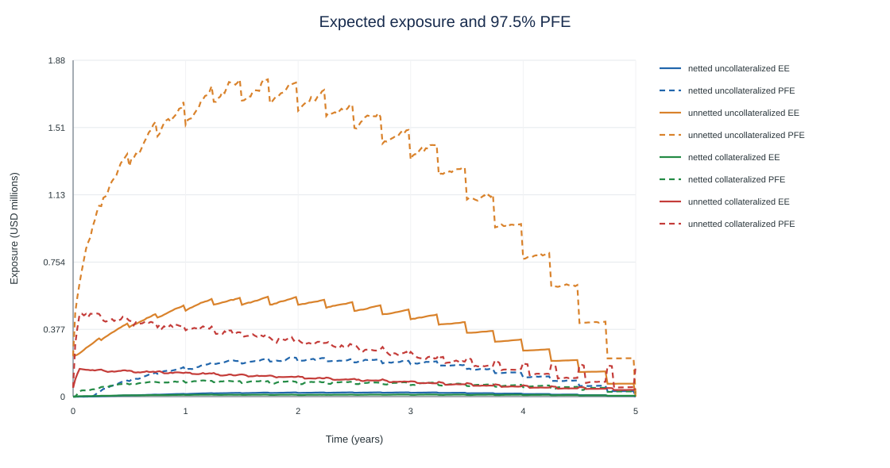
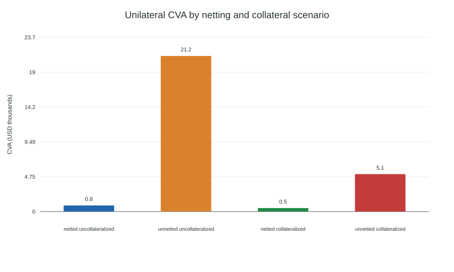

# Counterparty Credit Exposure and CVA Engine

A reproducible Python research project for simulating interest-rate swap exposure under the one-factor Hull-White short-rate model. It computes expected exposure (EE), expected positive exposure (EPE), 97.5% potential future exposure (PFE), and unilateral CVA, then compares netting and collateral scenarios.

The sample portfolio uses two offsetting five-year swaps. The analysis also compares Monte Carlo discounted cash flows with the curve-based swap value, studies path-count convergence, and varies market-model and collateral inputs.

## Features

- Exact Gaussian Hull-White transitions, including the correlated short-rate integral used for path discounting.
- Affine conditional zero-coupon bond prices calibrated to the initial discount curve.
- Regular-coupon fixed-for-floating swap valuation, including known floating fixings between coupon dates.
- Netted and standalone-trade exposure profiles.
- EE, running time-average EPE, 97.5% PFE, and constant-hazard unilateral CVA.
- Symmetric collateral with threshold, minimum transfer amount (MTA), and margin period of risk (MPOR).
- Analytic-versus-Monte-Carlo pricing benchmark, nested path-count convergence, and one-at-a-time parameter sensitivity.
- CSV tables, run metadata, and dependency-free SVG plots generated by the command-line workflow.
- A local dashboard that displays the bundled reference results in a browser.

## Quick start

Python 3.10 or newer is required.

~~~powershell
python -m venv .venv
./.venv/Scripts/python.exe -m pip install --upgrade pip
./.venv/Scripts/python.exe -m pip install -e .
./.venv/Scripts/python.exe -m cva_engine --paths 5000 --seed 2026 --output results
~~~

The default run uses antithetic paths and produces:

- scenario_summary.csv
- exposure_profiles.csv
- path_count_convergence.csv
- parameter_sensitivity.csv
- analytic_vs_monte_carlo.csv
- run_metadata.json
- exposure_profiles.svg
- cva_scenarios.svg
- pricing_convergence.svg
- parameter_sensitivity.svg

## Reference run

The checked-in reports/reference_run folder was generated with 5,000 paths,
seed 2026, a 2% hazard rate, and 40% recovery. Amounts below are USD.

| Scenario | CVA |
| --- | ---: |
| Netted, uncollateralized | 833 |
| Unnetted, uncollateralized | 21,189 |
| Netted, collateralized | 476 |
| Unnetted, collateralized | 5,093 |

For the receive-fixed sample swap, the analytic curve value was 228,025 and the
Monte Carlo discounted-cash-flow estimate was 227,333 (standard error 16,471;
95% interval 195,051 to 259,615). The path-count CSV contains the 1,000, 2,500,
and 5,000 path estimates. These are seeded illustrative results; they are not
general market or counterparty risk estimates.

## Browser dashboard

The dashboard is a read-only view of the bundled reference run. It lets you
switch exposure scenarios and inspect the exposure chart, CVA comparison,
convergence table, pricing interval, and model assumptions.

From the project folder, start the local web server:

~~~powershell
./.venv/Scripts/python.exe -m http.server 8765 --bind 127.0.0.1
~~~

Then open http://127.0.0.1:8765/app/ in a browser. The dashboard does not use a
live data feed or rerun the model; use the command-line workflow above to
generate a new set of report files.

For a faster run, use --paths 1000. Antithetic path counts must be even and the workflow requires at least 200 paths.

## Model outline

The short rate follows

$$
dr_t = [\theta(t)-a r_t]dt + \sigma dW_t,
$$

with the time-dependent shift chosen to fit the input discount curve. The model simulates the Ornstein-Uhlenbeck component exactly at observation dates and samples the matching integrated rate, so path discount factors do not rely on Euler time stepping.

For each path and exposure date, the swap is valued from conditional Hull-White zero-coupon bond prices. Positive exposure is then aggregated either after portfolio netting or trade by trade. Collateral is updated on the weekly simulation grid, subject to the agreement's threshold and MTA. During the MPOR, the prior collateral balance remains fixed.

The discrete unilateral CVA calculation is

$$
\mathrm{CVA}=(1-R)\sum_i P(0,t_i^*)\,\overline{EE}_i\,[S(t_{i-1})-S(t_i)],
\qquad S(t)=e^{-\lambda t},
$$

where R is recovery, lambda is the constant hazard rate, t_i* is the interval midpoint, and EE-bar is the trapezoidal average of endpoint expected exposures.

## Package layout

~~~text
src/cva_engine/
  curve.py          Discount curve representation
  hull_white.py     Hull-White bonds, paths, and discount factors
  instruments.py    Swap cash flows and conditional valuation
  exposure.py       EE, EPE, PFE, collateral, and CVA
  pricing.py        Analytic versus Monte Carlo pricing benchmark
  experiments.py    Scenario, convergence, sensitivity, and chart workflows
  __main__.py       Command-line interface
docs/
  assumptions.md    Conventions and limitations
~~~

## Reproducibility

The random seed, curve knots, model inputs, CSA terms, and observation frequency are saved in run_metadata.json. The convergence study uses nested subsets of the same antithetic path sample. Parameter sensitivities use common random numbers where the model parameters change.

## Scope

This is an educational and portfolio research implementation. It is not a production valuation or regulatory capital system. Important simplifying assumptions are listed in docs/assumptions.md.
